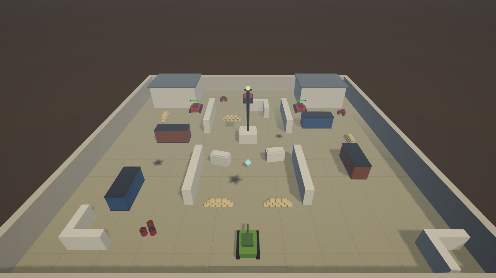

# ТАНКИ — Unity 6 (URP)

Навчальний проєкт курсу GoITeens «Gamedev»: 3D-гра, у якій гравець керує танком і бореться з ворожими танками на арені.

**Unity:** 6000.0.66f1 · **Render Pipeline:** URP 17 · **Сцена гри:** `Assets/Scenes/Game.unity`

## Керування

| Дія | Клавіші |
|---|---|
| Рух корпусу | ↑ ↓ ← → або W A S D (назад — 60% швидкості) |
| Поворот башти | Z / X або рух миші |
| Постріл | ЛКМ |
| Зброя | 1 — стандартна, 2 — скорострільна, 3 — важка |
| День / захід сонця | T |
| Перезапуск після кінця гри | R або кнопка «Грати знову» |

## Що реалізовано

- **Урок 71:** Player Controller на Rigidbody (MovePosition/MoveRotation), камера за баштою, Prefab `PlayerTank`, арена з перешкодами та стінами по краях.
  - ⭐ дві візуальні гусениці, швидкість назад — 60% від швидкості вперед, повідомлення «Танк почав рух / зупинився», керування також на W/A/S/D.
- **Урок 72:** бойова система через `TankConfig` (ScriptableObject), снаряд, `TankShooter` з cooldown, тир `Assets/Scenes/TestRange.unity` з 6 мішенями.
  - дві візуально різні кулі (`Projectile`, `ProjectileHeavy`);
  - ⭐ третій конфіг `HeavyTankConfig`, обмеження активних снарядів (`maxActiveProjectiles`), різний масштаб снаряда (`projectileScale`), мішені змінюють колір після влучання, перемикання зброї клавішами 1/2/3.
- **Урок 73:** Muzzle Flash, Trail, `ImpactEffect` зі звуком, loop двигуна, VFX самі видаляються.
  - ⭐ різні ефекти для ґрунту й металу (`ImpactSurface`: іскри та дзвін для металу), випадковий pitch пострілу 0.95–1.05, великий вибух для важкого снаряда, поштовх камери під час пострілу (`CameraShake`).
- **Урок 74:** ворожий AI на NavMesh: Patrol → Chase → Attack, наведення башти з `shootAngle`, повернення до патруля.
  - ⭐ випадкове очікування на патрульній точці, перевірка видимості через Raycast, вороги з різними швидкостями/дистанціями/зброєю (`EnemyTank_Fast_West`, `EnemyTank_Heavy_East`), колір Gizmos за поточним станом (зелений / жовтий / червоний).
- **Урок 75:** `IDamageable`, `TankHealth` з подіями, `TankDeath` з вибухом, HUD здоров'я та World Space смуги ворогів.
- **Урок 76 — левел-дизайн і URP:**
  - арена 50 × 50 з центральним і двома бічними маршрутами, головний орієнтир — радіовежа з маячком;
  - укриття: повні (стіни, контейнери, ангари), часткові (мішки з піском, бетонні блоки), кутові, м'які перешкоди (бочки);
  - ієрархія `Level / Ground, Blockout, Environment, Navigation, PatrolRoutes, SpawnPoints, Lighting`;
  - NavMesh перепечений під фінальну геометрію (радіус агента 1.3 під розмір танка);
  - URP/Lit матеріали, Directional Light з м'якими тінями, Global Volume: Tonemapping (ACES), Color Adjustments, Bloom, Vignette, White Balance;
  - ⭐ SSAO, Decal Projector (сліди вибухів), Fog, дві атмосфери (день і захід сонця, клавіша T), скриншоти до/після постобробки.
- **Урок 77 — фінальні правки:** лічильник знищених ворогів, екрани «Гру закінчено» і «Перемога» з перезапуском, перевірка видимості ворога (Raycast, щоб не стріляв крізь стіни), налаштування Player Settings і Windows Build.

## Скриншоти постобробки

| До | Після (день) | Після (захід) |
|---|---|---|
|  |  |  |

## ДЗ урок 79 — ООП

Папка `Assets/OOP_Homework`, сцена `Assets/OOP_Homework/OOP_Homework.unity` (WASD — рух гравця, на екрані видно HP ворогів і золото).

- 🟢 **Рівень 1:** `BaseCharacter` (`Health { get; protected set; }`, `characterName`) → `Warrior` з методом `Attack()`.
- 🟡 **Рівень 2:** `BankBox` (`Gold { get; private set; }`, `AddGold()`), `BankBoxTest` — пряма зміна `bankBox.Gold = 1000` дає помилку CS0272, тому золото додається лише через метод.
- 🔴 **Рівень 3:** `Enemy` (здоров'я, `TakeDamage()`, переслідування гравця) → `Orc` і `Troll`; `Troll.Regenerate()` відновлює 5 HP щосекунди через `Update`, одночасно рухаючись за логікою батька.

## Збірка

`File → Build Profiles → Windows → Build`, або меню **Tanks → 5. Build Windows Player** (результат у `Builds/Windows/Tanks.exe`).
